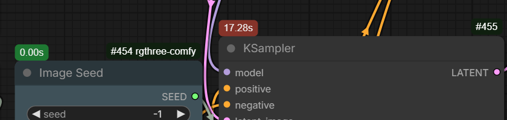

## NN-custom-nodes

### Execution Profiler

A lightweight execution profiler for ComfyUI that tracks node processing times and displays performance information directly in the workflow editor.

- Measures execution time for every executed node
- Displays timing badges on nodes in the frontend
- Tracks nested subgraph execution time
- Logs slow nodes to the console
- Configurable timing thresholds and colors
- Sends real-time profiler events to the UI

During execution, nodes receive live timing information:

- Node execution duration
- Slow node highlighting
- Subgraph accumulated execution time
- Execution status events



This helps identify workflow bottlenecks and optimize slow pipelines.

---

### 📐 Image Resolution

Calculates an image resolution based on width, height, aspect ratio, and orientation settings.

- Supports common aspect ratios
- Automatically calculates missing dimensions
- Maintains target pixel count when changing aspect ratios
- Rounds dimensions to a configurable divisor
- Supports portrait and landscape orientation

---

### 🎬 Video Resolution

Calculates video dimensions and frame count based on resolution, aspect ratio, duration, and frame rate.

- Supports image/video aspect ratios
- Calculates total frames automatically
- Keeps dimensions aligned for video models
- Supports portrait and landscape videos

---

### 🔍 Resolution Scale

Scales an existing resolution while keeping dimensions aligned and optionally limiting maximum size.

- Upscale or downscale resolutions
- Maintains aspect ratio
- Prevents exceeding maximum resolution
- Rounds dimensions for model compatibility

---

### 🎲 Wildcard Processor

A dynamic prompt expansion system for creating randomized prompts using wildcard files, selection blocks, variables, and reusable prompt templates.

Useful for:

- Prompt variation generation
- Batch image generation
- Large prompt libraries
- Reproducible randomized workflows

Features:

- **Random choice blocks**
  - Select random options using `{one|two|three}`
  - Select multiple options with count syntax `{2$$one|two|three}` or `{1-2$$one|two|three}`
  - Support variable-length selections with custom separator `{1-2$$, $$one|two|three|four}`

- **Weighted prompt options**
  - Control selection probability using weighted choices:
    - `{0.8::red|0.2::blue}`

- **External wildcard files**
  - Load reusable prompt lists from wildcard text files
  - Supports nested wildcard paths:
    - `__characters/age__`
    - `__styles/*__`

- **Custom variables**
  - Define reusable prompt values:
    - `{!style=cinematic portrait!}`
  - Reuse variables:
    - `{$style}`

- **Seed-based reproducible results**
  - Same seed produces the same wildcard selections and prompt expansion

- **LoRA tag cleanup**
  - Automatically removes LoRA tags:
    - `<lora:name:strength>`

- - **Comment handling**
  - Full-line comments using `#`
  - Hash symbols inside prompts are preserved:
    - `# character ...` → ignored
    - `dark #1 style` → kept
  - Inline block comments:
    - `portrait /* test variation */`

---

### ✨ Image CASharpening (Batch)

Applies Contrast Adaptive Sharpening (CAS) to images with batch processing support.

- GPU accelerated sharpening
- Batch-friendly processing
- Adjustable sharpening strength
- Optional CPU/GPU execution

---

### ✂️ Image Inset Crop

Crops an image by percentage values from each side.

- Percentage-based cropping
- Supports image batches
- Keeps crop positioning predictable

---

### 🔍 Image Upscale By

Upscales images using high-quality bicubic interpolation with anti-aliasing.

- Supports large batches
- GPU/CPU processing selection
- Memory-efficient chunk processing

---

### 👁️ Image Preview Gate

Provides a fallback preview image when no image is connected.

Useful for optional image inputs in workflows.

---

### 🎨 Image Color Range

Expands or remaps image color range.

Useful for restoring contrast from limited-range images.

---

### 🎚️ Image Adjust Contrast/Brightness

Adjusts image brightness and contrast.

---

### 🌈 Image Adjust Color

Adjusts individual RGB channel intensity.

---

### 🎛️ Image Adjust

Combined image adjustment node.

Supports:

- Brightness
- Contrast
- Saturation
- RGB channel adjustments

---

### 🎯 Contrast Adjust (Ref)

Matches image contrast to a reference image using luminance statistics.

Useful for:

- Style matching
- Consistent image batches
- Reference-based workflows

---

### 🖼️ Image Grid

Creates a grid layout from multiple images.

- Supports image batches
- Automatic cropping to target aspect ratio
- Configurable columns
- Resolution limiting

---

### 🎞️ Video Timeline

Creates a contact sheet/timeline preview from video frames.

Useful for:

- Reviewing generated animations
- Comparing frame sequences
- Debugging video workflows

---

### 📐 Image Resize (Batch)

Resizes image batches with resolution limits and model-friendly dimension alignment.

- Batch processing
- GPU acceleration
- Automatic maximum resolution limiting
- Dimension rounding support

---

### 💾 Image Saver

An advanced image saving node with support for multiple formats, automatic filename generation, batch saving, and workflow metadata preservation.

- Supports **PNG**, **JPEG**, and **WebP** output formats
- Automatic timestamp-based filenames
- Handles image batches
- Prevents filename collisions by creating unique filenames
- Preserves ComfyUI workflow and prompt metadata
- Supports PNG transparency (RGBA)
- Configurable quality settings
- Optional lossless WebP output

Supports dynamic filename placeholders:

- `%date`
  - Inserts the current date
  - Format: `YYYY_MM_DD`
  - Example: `2026_08_07`

- `%timestamp`
  - Inserts the current date and time
  - Format: `YYYY-MM-DD_HH-MM-SS`
  - Example: `2026-08-07_00-47-30`

- `%time`
  - Inserts the current time
  - Format: `HH-MM-SS`
  - Example: `00-47-30`

---

### 📁 Path Info

Extracts information from a file path and separates it into directory, filename, and path components.

Useful for workflows that need to manipulate saved image paths or process generated files.

---

### 🧹 Soft Clear Cache

Releases unused ComfyUI resources by unloading models, clearing GPU cache, and running garbage collection. Useful for long workflows or when managing limited VRAM.

---

### 🖼️ Image Optimize

Optimizes image tensors by ensuring they are stored in contiguous memory format. This can improve compatibility and performance for some operations.

---

### 🔍 InputCheck

Checks whether an input value is connected or empty.

---

### 🔀 Bool Switch

Selects between two inputs based on a boolean condition.

Uses lazy evaluation, meaning only the selected input is evaluated when needed.

---

## Configuration

The extension uses a `settings.toml` file to configure global behavior for wildcards and the execution profiler.

Configuration file:

---

### Wildcards Settings

```toml
[wildcards]

# Directory containing wildcard text files
path = "wildcards"

# Cache loaded wildcard files
# Disable to reload wildcard files without restarting ComfyUI
cache = true

# Remove LoRA tags from processed prompts
cleanup = true

# Separator used when selecting multiple wildcard options
delimiter = ", "

# Maximum recursive expansion passes
max_iterations = 5
```

### Profiler Settings

```toml
[profiler]

# Enable execution profiler
enable = true

# Print execution times to console
console_log = false

# Minimum execution time before logging
console_log_threshold = 0

# Decimal precision for displayed times
precision = 2

# Time threshold for slow node highlighting
slow_time = 10

# Frontend colors
active_color = "#4fc3f7"
badge_color = "#1e7832"
badge_color_slow = "#962828"
```
